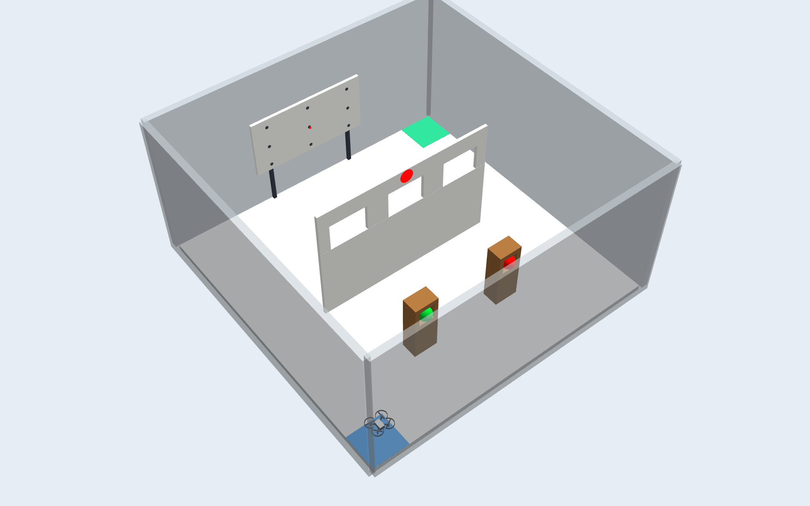
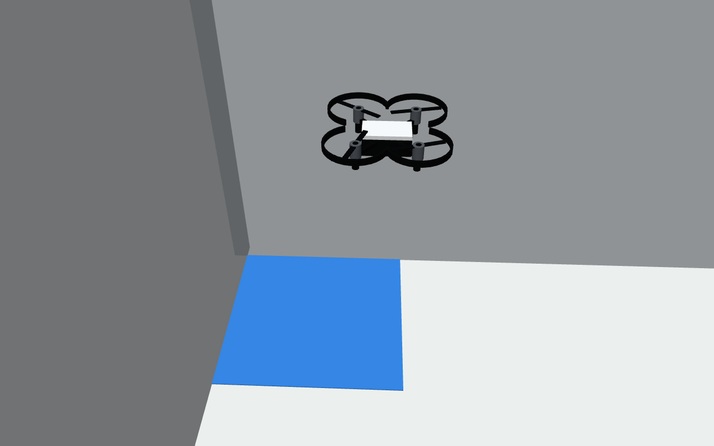
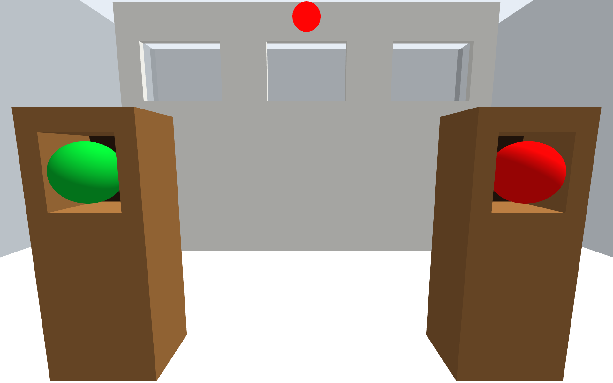
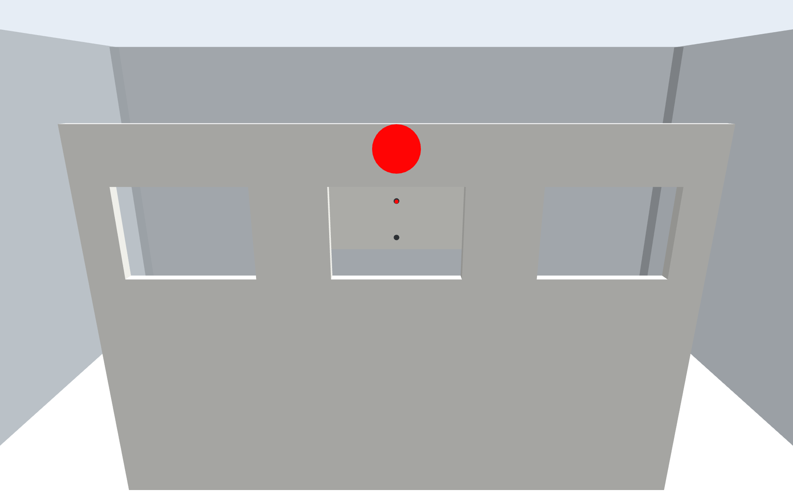
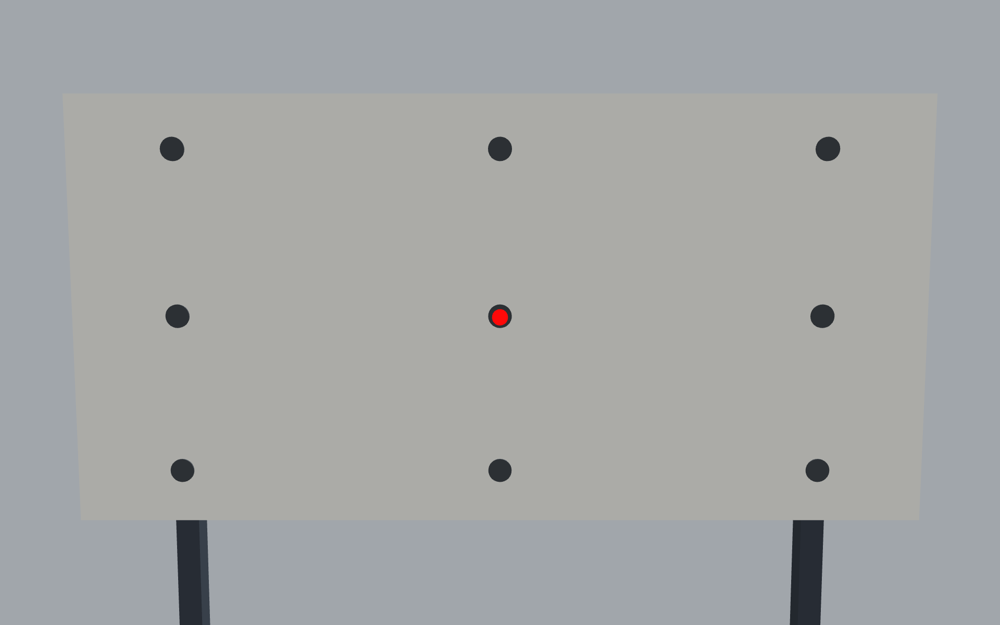

# Tello 初赛仿真环境

本目录可以整体放入 ROS 工作空间的 `src/`，使用 `catkin_make` 编译。
包含 Tello 尺寸训练机、PX4 飞控、Gazebo 场景、裁判和学生代码模板。
任务是：**起飞 → 两柜球色识别 → 穿着火点窗口 → 依次观察并接近三个红点 → 降落**。



上图为本课程场景与模型在 Gazebo 中的实际渲染。蓝色区域是起飞台，绿色区域是目标降落台；
两个球柜位于窗口前，三灯白板位于窗口后。球色、指定窗口和亮灯位置随 `seed` 改变。

## 1. 环境安装
首次使用时，需要安装 ROS/Gazebo/MAVROS 等系统依赖。已经配置好的 ROS2GO U盘系统可跳过。
建议在主目录下建立 tello_ws 来使用，并将 tello_sim.tar.gz 解压到 ~/tello_ws/src 下，以下也以此为例：
```bash
cd ~/tello_ws/src/tello_sim
bash tools/install_dependencies.sh
```

该脚本只通过现有软件源安装依赖，不修改软件源；需要联网及 sudo。如果报错请及时向助教反馈。

## 2. 放入工作空间并编译

目录结构应当是：

```text
tello_ws/
└── src/
    └── tello_sim/                 # 整个课程包；这一层不是 ROS 功能包
        ├── README.md
        ├── tello_px4_runtime/     # PX4、飞控插件、运行隔离与数据
        ├── tello_competition/     # 场景、相机、裁判、控制接口和 Action 消息
        ├── tello_control/         # 学生主要修改这里
        │   └── scripts/demo.py   # 最小订阅与飞行控制演示
        └── tools/                # 依赖安装工具
```

编译：

```bash
cd ~/tello_ws
catkin_make
source devel/setup.bash
```

每次打开新终端，都需要 `source ~/tello_ws/devel/setup.bash`。

## 3. 启动场景

一键启动：包括仿真环境和裁判机

```bash
source ~/tello_ws/devel/setup.bash
roslaunch tello_competition tello.launch
```

Gazebo 中会出现无人机、起降台、两个柜子、三个窗口和白板。

若需要将无人机与裁判分开启动，在两个终端分别执行：

```bash
# 终端 1：Gazebo、无人机飞控、场景及控制接口（不启动裁判）
roslaunch tello_competition drone.launch

# 终端 2：等终端 1 的场景初始化后，启动带实时终端界面的裁判
rosrun tello_competition final_judge.py _dashboard:=true
```


裁判机终端顶部持续刷新比赛计时、总分和分项得分，下方按时间记录起飞、球色提交、
穿窗、到达 target、降落及拒绝提交的原因。球色显示的是学生提交结果，不提前泄露答案。
计时使用**仿真时间**，起飞确认后开始，任意位置确认平稳落地后停止并结束本轮；等待起飞时为零。
落地仍需满足高度、速度、倾角条件并保持 1 秒，避免短暂触地误判；只有指定目标区降落才加 15 分。
如果位姿数据中断，会提示数据中断，不用墙钟时间伪造计时。终端至少 65 列 × 16 行，
可用方向键或 PgUp/PgDn 翻阅历史，End 回到最新；Q 或 Ctrl+C 会退出裁判节点。

学生程序需要向 `/tello/judge` 发布 `std_msgs/String`：球色如 `rg`，红点到达为
`target1`、`target2`、`target3`。裁判收到消息不等于一定得分，要看事件中的反馈。
启动例程前先监听 `/final/events`，以免错过瞬时事件；`/final/status` 可随时查看最新状态。

常用参数：

```bash
# 同时打开学生第一视角窗口
roslaunch tello_competition tello.launch camera_preview:=true

# 用不同种子改变球色、指定窗口和三灯位置
roslaunch tello_competition tello.launch seed:=23

# 关闭 Gazebo 主窗口，但仍使用真实渲染相机，需要可用的显示服务
roslaunch tello_competition tello.launch gui:=false
```

## 4. 运行最小控制演示

保持场景运行，打开第二个终端：

```bash
source ~/tello_ws/devel/setup.bash
rosrun tello_control demo.py
```

程序会打开第一视角窗口，以约 1 Hz 打印世界坐标位置 `x/y/z`（米）和
欧拉角 `roll/pitch/yaw`（度）。`demo.py` 中的 `quaternion_to_euler()` 将
`/tello/pose` 的四元数转换为欧拉角，话题本身仍保持标准 `PoseStamped` 格式。
等待飞控初始化后起飞约 0.48 m，向机体右侧以 0.10 m/s 飞行 2 个仿真秒，
短暂停顿，**从上方看逆时针旋转 90°**，再沿旋转后的机头方向以 0.10 m/s
前飞 2 个仿真秒，最后降落。旋转使用绝对航向反馈，容差 2°；平移仍是定时速度演示。
降落成功后向 `/tello/judge` 发送一次示例消息 `rg`（旋转柜红、固定柜绿）。
此时本轮已结束，裁判会拒绝该示例消息，不计分；正式比赛的识别结果应在落地前提交。

### 练习结束后放回起点

先等待无人机落地并解除解锁，停止所有飞行控制程序，再执行：

```bash
rosrun tello_control reset_start.py
```

同学们编写程序可以参考 `tello_control/scripts/demo.py`。

| 接口 | 用途 |
| --- | --- |
| `/tello/front_cam/camera/image` | 第一视角图像，`sensor_msgs/Image` |
| `/tello/front_cam/camera/camera_info` | 相机内参 |
| `/tello/pose` | Gazebo 世界坐标绝对位姿（真值），`geometry_msgs/PoseStamped` |
| `/tello/odom` | PX4 估计位姿/速度，`nav_msgs/Odometry` |
| `/tello/state` | 飞控连接、解锁和就绪状态，JSON 字符串 |
| `/tello/cmd_vel` | 速度控制，`geometry_msgs/Twist` |
| `/tello/takeoff`、`/tello/land` | 起降 Action，类型由 `tello_competition` 提供 |
| `/tello/judge` | 球色和红点到达提交，`std_msgs/String` |
| `/final/status`、`/final/events` | 分数和裁判反馈，JSON 字符串 |

无人机公共话题与起降 Action 统一使用 `/tello/` 前缀，不保留旧名称别名。
机体/相机坐标系分别为 `tello/base_link`、`tello/front_camera_optical`；世界坐标系仍为 `world`。
`/final/status`、`/final/events` 等比赛接口及内部 MAVROS/Gazebo/教师命名空间保持不变。

速度命令中的 `linear.x` 为机体向前、`linear.y` 为机体向左、`linear.z` 为世界向上，
`angular.z` 为偏航角速度。单位是 m/s、rad/s，建议 20 Hz 连续发布；0.5 s 未收到新指令会置零。
世界坐标 X 向右、Y 从起点朝白板、Z 向上。公共里程计与控制坐标的使用详见接口文档。

`/tello/pose` 可供学生定位，直接给出 Gazebo 中无人机模型原点的位置（米）和姿态（四元数），
`header.frame_id=world`，无需再加出生点偏移。学生模板通过 `self.pose` 保存最新消息。
查看方法：`rostopic echo /tello/pose`。此接口不改变 PX4 内部估计或起降控制。

学生需要实现视觉识别、导航、后退观察和结果提交；不得通过内部话题读取答案。
完整消息类型、速度限制、提交格式和裁判条件见 [学生接口](docs/student_api.md)。

## 6. 任务流程与计分

场地 2.75×2.75 m，三扇窗口的净尺寸均为 **宽 0.35 m × 高 0.25 m**，
窗洞中心离地 **0.82 m**，下沿离地 0.695 m、上沿离地 0.945 m；白板灯位为 3×3 布局。
裁判保留原有保守机体包络：穿窗期间横向中心误差需严格小于 3.5 cm，
高度偏差需严格小于 7 cm。这是计分限制，不等同于机体刚好不碰窗框的几何余量。

场地独立尺寸和位置以整厘米设置，半厘米按绝对值向上取整；窗洞中心高度按指定值设为 82 cm。
由中心和尺寸推导的边缘、几何体半高仍保留小数，以免改变净尺寸。
机体尺寸、装配/渲染间隙、飞控参数和裁判安全阈值不按厘米取整。

| 场地参数 | 当前值（cm） |
| --- | --- |
| 场地边长 | 275 |
| 外围墙高 / 厚 | 138 / 6 |
| 窗墙长 / 高 / 厚 | 165 / 110 / 3 |
| 窗洞宽 / 高 / 中心离地 | 35 / 25 / 82 |
| 窗口红标半径 / 中心离地 | 6 / 104 |
| 柜体宽 / 深 / 高 | 22 / 15 / 55 |
| 柜口宽 / 高 / 中心离地 | 14 / 15 / 43 |
| 柜板厚 / 球半径 | 2 / 6 |
| 两柜中心 X；Y | −42、42；−72 |
| 白板宽 / 高 / 顶端离地；Y | 110 / 55 / 90；136 |
| 红灯半径 | 1 |
| 白板灯位横坐标 / 纵坐标（从左上角） | 14、55、96 / 7、28、48 |
| 起降台边长 | 33 |

教师修改场地参数后，执行 `python3 tools/sync_world.py` 同步静态地图；
可用 `python3 tools/sync_world.py --check` 检查配置与地图是否一致。
修改出生位置时，还需同步 `tello.launch` 中的出生参数。学生直接使用已生成的地图即可。

| 顺序 | 任务 | 分数 |
| --- | --- | --- |
| 1 | 从起飞台上升超过 0.30 m，并保持 0.5 s | 15 |
| 2 | 识别旋转柜、固定柜的球色，按此顺序一次提交两字符 | 10+10 |
| 3 | 完整机体连续穿过红标指定窗口 | 20 |
| 4 | 识别当前亮起的红点，飞到跟前并提交；后退观察，再完成下一盏，共三次 | 10×3 |
| 5 | 在目标降落台内平稳降落，满足高度、速度和倾角条件并保持 1 s | 15 |

球色只接受整轮第一次提交，例如 `rg` 表示旋转柜红球、固定柜绿球。
颜色编码为 `r/g/b`，不含空格。
红点依次提交 `target1`、`target2`、`target3`；每次无人机中心距亮灯中心必须严格小于 **0.275 m**。
裁判确认成功后才会熄灭当前灯并点亮下一盏。
“后退观察”是课程任务要求；当前裁判核验顺序和距离，不自动证明是否后退或使用视觉。

### 子任务示意

以下图片使用本课程场景与模型，由 Gazebo 原生相机采集，展示场景和任务目标。
起飞图拍摄于实际起降自检过程，其余为场地局部视图；图片不代表自动完成比赛。

**① 起飞：从蓝色起飞台上升。** 裁判确认上升高度和保持时间后计分。



**② 识别球色：依次观察旋转柜和固定柜。** 等待球进入视野，再按“旋转柜、固定柜”的顺序
向 `/tello/judge` 提交两个颜色字符，例如 `gb`。示例图中的颜色仅对应本次场景。



**③ 穿窗：寻找上方带红色标记的窗口。** 调整位置和高度，让完整机体连续穿过指定窗洞；
此项由裁判自动判定，无需发送到点消息。



**④ 三灯任务：观察当前亮起的红点，接近后提交。** 白板为 3×3 灯位，每次只亮一盏。
靠近至距离小于 0.275 m 后，依次提交 `target1`、`target2`、`target3`；
每次确认成功后先后退，重新观察下一盏灯的位置，再接近。



**⑤ 降落：完成三灯后飞向绿色目标台。** 在台内平稳落地，满足高度、速度、倾角和保持时间要求。


查看裁判反馈：

```bash
rostopic echo /final/status
rostopic echo /final/events
```

需要重来时，先停止学生控制程序，再停止并重新启动仿真。
`/final/reset` 和 `/final/randomize` 留作教师调试接口，学生日常练习建议完整重启以重新初始化飞控。

## 7. 常见问题

- **找不到功能包**：确认目录层级正确，并执行 `source ~/tello_ws/devel/setup.bash`。
  使用 `rospack find tello_competition` 检查当前解析到的路径，避免加载旧课程工作空间。
- **找不到 MAVROS、Gazebo 插件或共享库**：执行依赖安装脚本；可用
  `rosrun tello_px4_runtime check_runtime.py --integrity --libraries` 检查 PX4 运行文件。
- **相机无图、图形初始化失败**：确认当前桌面可用；`gui:=false` 仍然需要图形渲染支持。
  先检查 `rostopic hz /tello/front_cam/camera/image`，再检查 Gazebo 的报错。
- **刚启动不能起飞**：等待 `/tello/state` 中 `ready` 为真，并再留几秒给飞控估计器初始化。
- **端口占用**：退出之前的 PX4/Gazebo 仿真。程序不会自动结束其他仿真进程。
- **编译时 Python 包找不到**：退出 Conda，使用上面的 `/usr/bin/python3` 编译命令。

课程代码及模型来源见 [THIRD_PARTY.md](THIRD_PARTY.md)，本机验收记录见 [docs/VALIDATION.md](docs/VALIDATION.md)。
教师重新构建 PX4 运行组件的方法见 [docs/MAINTENANCE.md](docs/MAINTENANCE.md)。
